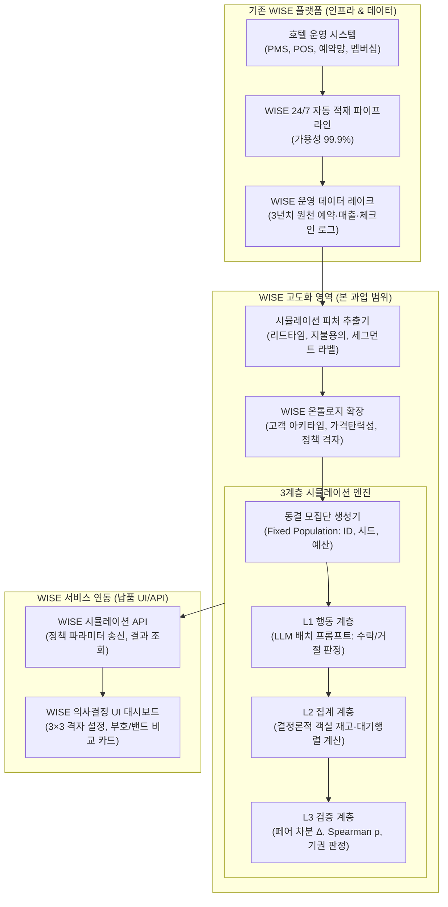

# 워커힐 호텔 에이전트 시뮬레이션 — 방법론 절 및 Phase 0 게이트

> **문서 성격**: 제안서 본문 삽입용 초안 (v0.1). §1–§4는 방법론 장, §5–§6은 로드맵 장으로 분리 삽입.
> **기준 문헌**: M. Majidi, J. Yang, A. Beheshti, "LLM-Based Agent Simulation Data Product for Counterfactual Evaluation of Hotel Dynamic Pricing," *Proc. 2026 IEEE Int. Conf. Web Services (ICWS)*, Sydney, 2026, pp. 1362–1372, doi:10.1109/ICWS72778.2026.00170.
> **인용 등급 원칙**: 해당 논문 본문은 미확보 상태이며, 본 문서는 **초록이 지지하는 범위**로만 동 논문을 인용한다. 동 논문의 구현 디테일(아키타입 캘리브레이션 절차, 배칭 프롬프트 구조, 정책 임계값 정의)은 본 과업 설계로 대체하며, "논문 방식을 재현한다"고 표기하지 않는다. 근거 등급표는 §8.
> **수치 표기**: 본 문서의 모든 임계값·기준선은 **협의 가능한 제안 기본값**이다.

---

## 0. 요약: LLM 시장 시뮬레이션의 구성 타당성 위기와 본 과업의 해결책

본 과업은 워커힐 호텔에 기구축된 커먼컴퓨터의 **WISE(운영 데이터 통합·자동 적재 인프라, 24/7·99.9% 가용성)**를 기반으로, 호텔 가격·상품 정책의 사전 평가를 수행하는 **시뮬레이션 엔진을 WISE 플랫폼의 신규 지능형 데이터 제품으로 고도화**하는 과업이다.

### 0.1 배경: LLM 에이전트 시장 시뮬레이션의 치명적 허점 (구성 타당성 실패)

최근 AI 학계(IEEE/ACM 및 컴퓨팅 사회과학 분야)에서는 AI 에이전트를 가상 시장에 투입해 가격·이익·소비자 후생을 시뮬레이션하고 정책 효과를 평가하는 기존 연구들이 **심각한 구성 타당성 오류(Construct-Validity Failure)**를 범하고 있음을 강력히 고발하고 있다:
1. **프로토콜 격리 실패 (불공정한 비교 조건)**: 정책 대조군과 실험군 간에 서로 다른 입·출력 양식(스키마)을 사용하여, 실제 정책의 효과가 아니라 시스템 인터페이스의 편의성 차이가 결과로 왜곡되는 문제. 동일한 양식으로 통제하면 발표된 효과가 대폭 축소되거나 음(-)으로 반전됨.
2. **확률적 불안정성과 인센티브 불일치**: LLM의 단발성 응답 변동성을 다회차 부트스트랩으로 검증하지 않아 통계적 유의성이 결여되며, 에이전트에게 "수익을 극대화하라"고 지시해도 역효과가 발생하는 등 경제적 인센티브가 작동하지 않는 구조적 한계.
3. **가짜 정밀성(Spurious Precision)의 오용**: "매출 12.4% 상승"과 같은 그럴듯한 점추정치를 경영진에 보고하여 비즈니스 의사결정을 심각하게 오도하는 위험.

### 0.2 본 과업의 돌파구: '구성 타당성 계약(Construct-Validity Contract)'의 전면 도입

본 과업은 이러한 선행 연구의 치명적 결함을 정면으로 돌파하기 위해, **'구성 타당성 계약(Construct-Validity Contract)'**이라는 엄격한 검증 체계를 시뮬레이션 전 과정에 강제한다:
- **프로토콜 격리 완벽 보장**: 대조군과 실험군에 100% 동일한 프롬프트 스키마와 동결 모집단(`population_id`)을 적용하고, 오직 페어 차분($\Delta$)으로 정책 효과를 분리.
- **인센티브 불일치 원천 차단 (L1/L2 엄격 분리)**: LLM에게 경제적 계산이나 수익 극대화를 시키지 않고(L1은 수락/거절 판독만 수행), 모든 매출·ADR·점유율 계산은 100% 결정론적인 L2 회계 엔진이 전담.
- **가짜 정밀성 배제**: 점추정치 출력을 스키마 레벨에서 원천 금지하고, 방향(`+`/`-`), 상대 순위, 5대 세그먼트별 부호만 산출물로 계약.
- **확률적 변동성 통제 및 정직한 침묵**: 다회차($N=20$) 부트스트랩 반복 실행을 강제하며, 순위가 뒤집히거나 부호 일치율이 70% 미만이면 가짜 숫자를 내지 않고 즉시 **기권(`abstain = true`)**을 선언.
- **Held-out 실적 대비 실증 검증**: 선행 연구가 미완 과제로 남긴 과거 주말 8개 대상 사후 순위 재현(Spearman $\rho \ge 0.6$, 방향 적중률 $\ge 70\%$) 백테스트를 통과해야만 납품 완료.

---

## 1. WISE 고도화 아키텍처 및 방법론 구조

### 1.1 WISE 플랫폼 고도화 연계 아키텍처

본 시뮬레이션 시스템은 독립된 사일로(Silo)가 아니라, **워커힐 WISE 플랫폼의 상위 분석·시뮬레이션 계층으로 완벽히 통합**된다.



### 1.2 WISE 고도화 납품 범위 및 기능 명세

| 구분 | 모듈/기능 | 세부 내용 및 납품 산출물 | 연동 방식 |
|---|---|---|---|
| **온톨로지** | **WISE 온톨로지 확장** | • 5대 고객 세그먼트 및 아키타입 행동 속성 정의<br/>• 객실 타입별 재고 및 동적 가격 정책 엔티티/관계 확장 | WISE 메타데이터 카탈로그 |
| **데이터** | **시뮬레이션 피처 파이프라인** | • WISE 3년치 예약 로그 기반 리드타임·ADR·취소율 특성 추출<br/>• 아키타입 모멘트 매칭 및 가격민감도 캘리브레이션 모듈 | WISE 적재 배치 잡 |
| **엔진** | **L1 행동 판정 모듈** | • Pydantic 기반 배칭 LLM 프롬프트 (수락/거절/사유코드)<br/>• 숫자/금액 생성 원천 차단 (P1 원칙 준수) | 독립 컨테이너 모듈 |
| **엔진** | **L2 결정론적 집계 엔진** | • 일자별 잔여 객실 차감 상태 머신<br/>• F&B/부대시설 대기행렬(M/M/c) 이벤트 시뮬레이터 | 내부 실행 라이브러리 |
| **엔진** | **L3 검증 및 의사결정 계약** | • 고정 모집단 페어 차분기 ($\Delta = B - A$)<br/>• 순위 안정성(부호 일치율) 및 기권(Abstention) 판정 로직 | 배치 평가 엔진 |
| **인터페이스** | **WISE 시뮬레이션 API** | • 정책 격자(3×3) 파라미터 전달 및 시뮬레이션 트리거 API<br/>• 오용 방지 JSON 스키마 기반 결과 반환 API | REST / gRPC |
| **사용자 화면** | **WISE 의사결정 UI 카드** | • 경영진/마케터용 정책 비교 카드 컴포넌트<br/>• 점추정치 배제, 방향(`+`/`-`), 효과 밴드, 세그먼트별 부호 시각화 | WISE 웹 프론트엔드 연동 |
| **품질/법무** | **백테스트 및 SBOM** | • 과거 8개 주말 대상 사후 순위 재현 검증 리포트 ($\rho \ge 0.6$)<br/>• AGPL 격리 및 컴플라이언스 심사용 라이선스 SBOM 명세서 | 기술 문서 / 보고서 |

### 1.3 방법론 구조: 3계층 분리

| 계층 | 역할 | 구현 | 결정론성 | 출력 |
|---|---|---|---|---|
| **L1 행동 계층** | 아키타입별 예약 수락/거절 판정 | LLM 에이전트 + 배치 프롬프트 | 확률적 | 판정 + 사유코드 |
| **L2 집계 계층** | 매출·점유율·ADR·대기시간 계산, 재고 차감 | 결정론적 코드 (이벤트 기반) | 결정론적 | 원시 지표 |
| **L3 검증 계층** | 방향 적중률·순위 상관 채점, 기권 판정 | 백테스트 스크립트 | 결정론적 | 통과/기권 |

### 1.4 핵심 설계 원칙

- **P1 — 숫자는 L1에서 생성하지 않는다.** L1은 "이 가격에 예약한다/하지 않는다"와 사유만 출력한다. 매출·ADR·점유율은 L2가 계산한다. 따라서 모든 수치는 가정과 수식으로 추적 가능하다.
- **P2 — 정책 비교는 고정 모집단 페어 차분으로만 한다.** 정책 간 절대 수준 비교는 보고하지 않는다 (§2.1).
- **P3 — 점추정치를 출력 포맷에서 배제한다.** 단일 비율·단일 금액 필드는 스키마 수준에서 금지한다 (§3.1).

---

## 2. 비교 설계

### 2.1 고정 모집단 페어링 (선행 연구 설계 계승)

**절차**

1. 과거 예약 로그에서 세그먼트 구성비를 산출한다.
2. 아키타입별 가격민감도를 캘리브레이션한다 (§4.3).
3. 고객 집단을 **동결**하고 `population_id`를 발급한다. 동결 대상: 아키타입, 예산, 숙박일, 탐색 이력, 난수 시드.
4. 정책 A와 B를 **동일한 `population_id`** 로 각각 실행한다.
5. 산출은 차분만: `Δ = outcome(B) − outcome(A)`. 절대 수준은 보고하지 않는다.

**왜 유효한가.** 모델은 계통 편향(세그먼트 과대·과소 대표, 지출 과소 추정 등)을 갖지만, 동결된 동일 집단에 정책만 바꿔 적용하면 그 편향이 양쪽에 동일하게 실려 차분에서 상당 부분 소거된다. 반면 "매출 12% 증가"와 같은 절대값은 편향을 그대로 노출한다.

**한계 (명시할 것).** 차분이 소거하는 것은 **정책과 무관한** 편향에 한한다. 정책이 편향과 상호작용하는 경우(예: 할인 정책 × 가격민감도 과대추정) 잔차가 남는다. 이 잔차는 §4.4의 순위 안정성 검사로 감시하며, 잔차가 큰 시나리오는 기권 처리한다.

### 2.2 정책 격자

점유율 구간 × 도착 잔여일의 3×3 격자로 정의한다. (수치 예시, Phase 0에서 확정)

| 점유율 | D-30 | D-14 | D-7 |
|---|---|---|---|
| ≥ 80% | +8% | +10% | +12% |
| 60–80% | 0% | 0% | +3% |
| < 60% | −5% | −8% | −10% |

**이유.** 단일 지점 비교는 국소 효과를 전역 결론으로 오독하게 만든다. 격자 스캔으로 **부호 전환점**을 탐지해 "이 구간을 넘으면 효과 방향이 뒤집힌다"를 보고할 수 있어야 한다.

### 2.3 세그먼트별 부호 보고 (선행 연구 설계 계승)

총합 지표와 함께 **5개 세그먼트의 부호**를 항상 병기한다. 세그먼트 중 하나라도 음의 부호이면 "총합 개선"이라는 표현을 사용하지 않는다. 선행 연구의 사례에서도 총합은 점유율·매출이 증가했으나 **럭셔리 지향 고객의 전환율은 하락**했다. 워커힐의 핵심 세그먼트가 럭셔리이므로 이 항목은 필수 보고 대상이다.

### 2.4 배칭 적용 경계

| 대상 | 배칭 | 근거 |
|---|---|---|
| 객실 가격 판정 | **적용** | 개별 구매 결정이 다른 에이전트의 결정과 독립적이라고 볼 수 있음 |
| F&B·힐카페 대기·혼잡 | **비적용** | 상호작용(대기 행렬, 좌석 경쟁)이 현상의 본질 |

**명시적 가정.** 배치 내 에이전트 간 통신은 없다. 이 가정이 성립하지 않는 시나리오는 시뮬레이션 범위에서 제외하며, 제외 목록을 산출물에 첨부한다. 시설 혼잡은 L2의 이벤트 기반 대기행렬 모델로 처리한다.

---

## 3. 구성 타당성 계약(Construct-Validity Contract) 및 오용 불가능 산출물 스키마

경고 문구를 붙이는 방식은 실패한다. 실무 보고서에서는 캡션이나 전제 조건을 지우고 자극적인 숫자만 인용되기 때문이다. 이는 시장 시뮬레이션의 **가짜 정밀성(Spurious Precision)에 의한 구성 타당성 실패**를 야기한다.

따라서 본 과업은 **'구성 타당성 계약(Construct-Validity Contract)'**을 체결하고, **출력 스키마 자체에서 점추정치(단일 금액/비율)를 원천 제거**한다. 오직 방향성과 효과 구간, 세그먼트별 반응, 기권 여부만을 출력함으로써 잘못된 정책 의사결정을 구조적으로 방지한다.

### 3.1 스키마

```json
{
  "scenario_id": "WH-2026-Q3-STR-014",
  "population_id": "POP-BASE-01",
  "policy_pair": { "base": "STATIC", "test": "OCC_LADDER_V2" },
  "direction": "+",
  "effect_size_band": "medium",
  "segment_signs": {
    "luxury": "-", "family": "+", "corporate": "0",
    "casino_visitor": "+", "local_dayuse": "0"
  },
  "rank": 2,
  "sign_agreement": 0.87,
  "sensitive_parameters": ["luxury_price_elasticity"],
  "abstain": false,
  "abstain_reason": null
}
```

**금지 필드**: `revenue_delta_pct`, `revenue_delta_krw`, `confidence_interval`(좁은 구간). 구간이 필요하면 `effect_size_band`(small/medium/large)로만 표현한다. 좁은 신뢰구간은 정밀해 보이는 착시만 만든다.

### 3.2 기권(abstention) 규칙

| 조건 | 처리 |
|---|---|
| 반복 실행 부호 일치율 < 0.70 | `direction = "inconclusive"` |
| 민감 변수 1개 변동이 `effect_size_band`를 뒤집음 | `abstain = true`, `abstain_reason` 기재 |
| 두 정책의 순위가 반복 실행에서 뒤집힘 | `rank = null` |

기권은 실패가 아니라 정상 출력이다. **오답보다 정직한 침묵을 우선한다.** 기권률은 성과 지표로 계상한다(§4.2).

### 3.3 보고 예시

- **허용**: "동적 가격 사다리는 정적 가격 대비 점유율·매출 방향이 양(+)이며, 럭셔리 세그먼트에서는 음(−)이다. 효과 크기는 중간 구간, 순위는 후보 5개 중 2위. 부호 일치율 0.87."
- **금지**: "동적 가격 도입 시 매출이 12.4% 증가한다." / "연 매출 38억 원 증가 기대."

---

## 4. 검증 계층 — 선행 연구의 미완 과제

선행 연구는 스스로를 "정책 평가를 위한 calibrated proof of concept"으로 규정하고, 예측 충실도 검증을 future work로 남겼다. 본 과업은 이 지점을 수행한다.

### 4.1 백테스트 설계

- 실적이 확정된 과거 기간 N개를 대상으로 한다(주말 단위 권장, 최소 8개).
- §2.2 격자에서 후보 정책 5개를 선정한다.
- 각 기간에 대해 **실제 성과 순위**와 **시뮬레이션 순위**를 산출한다.
- 지표: Spearman ρ, 방향 적중률, 기권률.

**채점 방식 주의.** 절대 오차(MAPE)로 채점하지 않는다. 계통 편향 때문에 저주파이며, MAPE 최소화는 "틀린 모델을 정교하게 만드는 것"으로 귀결된다.

### 4.2 합격 기준 (제안 기본값)

| 항목 | 기준 | 의미 |
|---|---|---|
| 방향 적중률 | ≥ 70% | 이진 판단의 실용 하한 |
| 순위 상관 | Spearman ρ ≥ 0.6 | 5개 후보 순위 재현 |
| 기권률 | ≤ 20% | 유용성 하한 |
| 순위 안정성 | 반복 실행 부호 일치 ≥ 80% | 재현성 |

**미달 시 조치.** 기준 미달을 숨기지 않고 "본 방법론은 워커힐 가격 정책 평가에 부적합"으로 보고한다. 이 조항을 계약 조건에 포함할 것을 제안한다. 이를 포함하지 않으면 프로젝트는 검증 불가능한 주장을 납품하게 된다.

### 4.3 캘리브레이션

| 단계 | 방법 | 산출물 |
|---|---|---|
| 1. 구성비 | 과거 로그의 세그먼트 점유율에 아키타입 혼합 가중치를 모멘트 매칭 | 가중치 표 |
| 2. 민감도 | 과거 ADR–전환율 쌍에 대해 아키타입별 가격민감도 1변수 격자 탐색. 목적함수 = 관측 점유율 오차 | 민감도 표 + 적합 오차 |
| 3. 홀드아웃 | 캘리브레이션 기간과 검증 기간을 분리 | 분리 기준일 |

**필수 조건**: 동일 데이터로 캘리브레이션과 채점을 동시에 수행하지 않는다.

### 4.4 순위 안정성 (LLM 비결정성 방어)

- 동일 `population_id`로 반복 실행한다(배칭 하 N ≈ 20, 비용 상한 설정).
- 부호 일치율과 순위 뒤집힘 횟수를 기록한다.
- 통제 수단: temperature 고정, 구조화 출력(JSON) 강제, 집단 동결, 프롬프트 버전 해시 기록.

---

## 5. Phase 0 게이트 (2–3주)

목적: 논문 본문 없이 확정 가능한 항목을 먼저 닫고, 데이터 접근성을 확인한다.

| # | 항목 | 미확보 사유 | 확정 방법 | 산출물 | 판정 기준 | 실패 시 |
|---|---|---|---|---|---|---|
| A | 아키타입 캘리브레이션 | 논문 본문 미확보 | §4.3 자체 설계 + 저자 회신 반영 | 캘리브레이션 리포트 | 과거 점유율 재현 오차 ≤ 5%p | 자체 설계로 확정 진행 |
| B | 배칭 구조 | 논문 본문 미확보 | 자체 설계 + 저자 회신 | 프롬프트 스펙 문서 | 1일 1호출로 전원 판정 가능 확인 | 배치 크기 축소 |
| C | 정책 임계값 | 논문 본문 미확보 | 경영진 인터뷰 + 가격 격자 | 정책 격자표 (3×3) | 경영진 합의 | 후보 수 축소 |
| **D** | **WISE 온톨로지 매핑 및 피처 추출** | 기존 데이터와의 매핑 미정의 | WISE-시뮬레이션 온톨로지 매핑 & 피처 파이프라인 설계 | 시뮬레이션 온톨로지 명세서 & 피처 추출기 | 필수 피처(리드타임, 지불용의, 세그먼트) 매핑 커버리지 ≥ 95% | **프로젝트 중단/재설계 검토** |
| E | 라이선스(SBOM) 확인 | 의존성 미조사 | SBOM 생성 + 라이선스 스캔 | SBOM 문서 | 제약 라이선스(AGPL 등) 0건 또는 격리 완료 | 해당 모듈 대체 |

**D 관련 현황 및 재정의.** 워커힐에는 이미 커먼컴퓨터의 WISE(운영 데이터 통합, 업장 데이터 자동 적재 24/7·99.9%)가 성공적으로 운영 중이다. 따라서 본 과업의 리스크는 '신규 데이터 수집 여부'가 아니다. 핵심 과제는 **WISE가 보유한 3년치 운영·예약 데이터에서 에이전트 캘리브레이션에 필수적인 행동 피처(예약 리드타임, 결제액 기반 가격민감도 프록시, 취소 패턴, 세그먼트 태그)를 추출하고, 이를 시뮬레이션 온톨로지 엔티티로 매핑**하는 것이다. 이미 검증된 WISE 인프라를 활용하므로 데이터 파이프라인 구축 비용과 리스크를 획기적으로 절감할 수 있다.

**Gate 통과 조건**: A·B·C 산출물 존재 + D·E 확정. **D 미해결 시 Phase 1 진입 금지.**

**Kill criteria (사전 합의)**

1. D(WISE 시뮬레이션 온톨로지 매핑 및 피처 추출 파이프라인)가 2주 내 미해결.
2. §4.2 홀드아웃 검증에서 방향 적중률 < 55%.
3. 기권률이 2회 연속 50% 초과.

---

## 6. 로드맵 재정의

| Phase | 기존 표현 | 수정 표현 | 통과 기준 |
|---|---|---|---|
| 0 | (없음) | 방법론·데이터 확정 | §5 Gate |
| 1 | "대기 줄과 매출 상관관계 시뮬레이션 및 검증" | **과거 주말 8개의 정책 대안 순위 사후 재현** | 방향 적중률 ≥ 70%, ρ ≥ 0.6 |
| 2 | "신상품 반응 및 잠식 효과 분석" | **잠식의 부호·상대 크기 비교** (격자 스캔 필수) | 부호 일치율 ≥ 0.8 |
| 3 | "경쟁사 프로모션에 따른 점유율 변화 정량 시뮬레이션" | **경쟁사 프로모션 3종에 대한 자사 대응 옵션 카드** | 정량 수치·방향 주장 금지 |

**Phase 3 한정 사항**: 경쟁사의 대응 행동(게임적 반응)은 선행 연구 범위 밖이며, 본 과업에서도 모델링하지 않는다. 따라서 Phase 3 산출물은 "예측"이 아니라 **시나리오 생성기**로 규정하고, 모든 결론 문장에 "경쟁 반응 가정 하에서" 조건을 명기한다.

---

## 7. 리스크 및 대응

| 구분 | 리스크 | 대응 |
|---|---|---|
| 기술 | 경쟁사 반응 미모델링 | Phase 3를 시나리오 카드로 한정, 정량 주장 금지 |
| 기술 | 배칭 가정 위반 (에이전트 상호작용) | 시설 혼잡은 L2 이벤트 모델로 분리, 제외 목록 공개 |
| 통계 | 다중 비교 (정책 5개 × 기간 8개) | 순위 검정으로 완화, 개별 p값 보고 금지 |
| 비용 | 반복 실행 N회 × 배치 호출 | N 상한 설정, 배칭으로 통제, 실행 예산 상한 계약 |
| 법무 | **AGPL-3.0** (MiroFish) | MiroFish는 AGPL-3.0이다. §13은 **수정 후 네트워크 제공** 시 발동하므로, 본 과업에서는 **내부 실험용으로만 사용하고 수정본을 고객에게 배포하지 않는다.** 납품 아키텍처는 커먼컴퓨터의 자체 온톨로지/MCP 스택을 사용하므로 AGPL 전파 대상이 아니다. 아이디어·방법론은 저작권 대상이 아니므로 자체 구현이 우회 경로다 |
| 법무 | 의존 라이브러리 라이선스 미확인 (OASIS 등) | Phase 0에서 **SBOM 생성 + 라이선스 스캔**(Gate E). AGPL·제약 라이선스 발견 시 해당 모듈 격리 또는 대체 |
| 법무 | 고객 데이터의 외부 SaaS(Zep Cloud) 전송 | 자체 메모리 계층으로 대체, 개인정보 비식별화. 부득이 외부 전송 시 국외이전 고지·동의 절차 |
| 법무 | 납품물 소스 공개 범위 | 고객사 컴플라이언스 심사 대응용 SBOM 첨부. 방법론·검증 코드의 소유권을 계약에 명시 |
| 조직 | 산출 수치의 단독 인용 | 시뮬레이션 출력은 인간 작성 비즈니스 케이스의 **비교 근거**로만 첨부. 단독 인용 시 반려 규정 |

### 7.1 라이선스 의무 발생 조건 (AGPL 판단 기준)

의무를 결정하는 것은 "AGPL을 썼는가"가 아니라 **① 수정했는가 ② 남에게 제공했는가** 두 가지다.

| 상황 | 소스 공개 의무 | 근거 |
|---|---|---|
| 사내에서만 사용, 외부 제공 없음 | 없음 | 배포·네트워크 제공 아님 |
| 수정 없이 그대로 외부 SaaS로 제공 | **없음** (§13은 *수정 시* 발동) | AGPLv3 §13 |
| **수정해서** 네트워크 서비스로 제공 | 있음 — 이용자 전원에게 Corresponding Source | AGPLv3 §13 |
| 수정본 또는 바이너리를 고객사에 납품 | 있음 | GPLv3 §6 |
| 라이브러리로 링크·import | 전파됨 — 자사 코드에도 적용 | 결합물 판단 |
| 별도 프로세스로 분리, HTTP API 호출만 | 일반적으로 미전파 (경계가 모호하면 다툼 소지) | 파생물 판단 |

**유의**: AGPL은 상업적 사용을 금지하지 않는다. 실질 리스크는 제재가 아니라 **소스를 받은 고객·경쟁사의 합법적 재배포로 독점 기반이 사라지는 것**이다. 또한 호텔·금융 등 규제 산업 고객은 도입 시 SBOM/라이선스 심사를 수행한다.

---

## 8. 근거 등급표

| 주장 | 근거 | 등급 |
|---|---|---|
| 소멸성 재고 정책의 반사실 평가는 직접 측정 불가 | 동 논문 초록 | 직접 인용 가능 |
| 고정 모집단 페어 비교로 정책 효과 분리 | 동 논문 초록 | 직접 인용 가능 |
| 배칭 프롬프팅으로 계산 실현성 확보 | 동 논문 초록 | 직접 인용 가능 |
| 총합 개선에도 럭셔리 세그먼트 전환율 하락 가능 | 동 논문 초록 사례 | 직접 인용 가능 |
| 동 논문은 검증된 수요예측 모델이 아님 | 동 논문 초록 자기 규정 | 직접 인용 가능 |
| 아키타입 캘리브레이션 절차 | 본 과업 설계 | 재현 주장 금지 |
| 배칭 프롬프트 구조 | 본 과업 설계 | 재현 주장 금지 |
| 정책 임계값 정의 | 본 과업 설계 | 재현 주장 금지 |
| 절대 수치의 신뢰 불가 | 선행 문헌 일반 + 동 논문 자기 규정 | 해석 |
| 합격 기준 임계값 (70% / 0.6 / 20%) | 본 문서 제안값 | 협의 대상 |

---

## 9. 다음 단계

1. §5 표의 A·B·C를 저자 회신으로 대체할 수 있는지 확인 (요청 메일 발송).
2. D(WISE 온톨로지 매핑 및 피처 추출)를 Phase 0 최우선 과제로 착수. WISE 운영 데이터 레이크에서 캘리브레이션용 시뮬레이션 피처 파이프라인을 조기 구축하여 L1/L2 연동 지연 방지.
3. §4.2 합격 기준과 §5 Kill criteria를 계약서 조항으로 승격.
4. Gate E(SBOM + 라이선스 스캔)를 Phase 0 착수 즉시 실행 — AGPL·제약 라이선스 발견 시 해당 모듈 격리.
5. 논문 PDF 확보 시점(제안 통과 후)에 §4.3·§2.2를 재검토하고, 변경 사항을 변경 이력에 기록.
